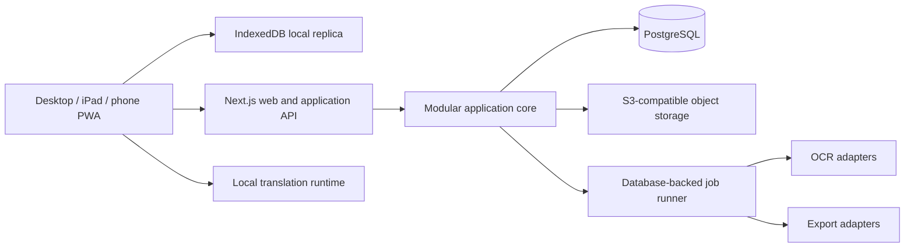

# Architecture

## 1. System overview

The approved architecture is a TypeScript modular monolith delivered as a responsive Next.js PWA, backed by PostgreSQL and S3-compatible object storage. A local IndexedDB replica supports offline work. Sync is explicit and revision-checked. Compute-heavy OCR, export, and optional server jobs run through an in-process worker deployment from the same codebase and database; this is not a microservice boundary.



## 2. Approved technology stack

| Concern | Decision |
|---|---|
| Language | TypeScript with strict compiler settings |
| Repository | pnpm workspace monorepo |
| Web/PWA | Next.js + React + service worker/manifest |
| Editor | Tiptap on ProseMirror with a versioned custom schema |
| PDF | Mozilla PDF.js; original bytes remain immutable |
| Database | PostgreSQL |
| Data access | Prisma for CRUD/transactions; SQL where constraints or performance require it |
| Object storage | Private S3-compatible bucket with checksums and presigned access |
| Citations | CSL-JSON canonical metadata + citeproc-js or another CSL 1.0.2-compatible processor behind a port |
| Offline | IndexedDB through a typed repository layer; Cache Storage for app shell/assets |
| Validation/contracts | Zod schemas shared at boundaries |
| Tests | Vitest, Testing Library where useful, Playwright, test PostgreSQL/S3 emulator |
| Jobs | PostgreSQL-backed job table and separate worker process from the same application package |
| Observability | Structured logs, request/job correlation IDs, privacy-safe error reporting |

The implementation agent must benchmark citation processors and local inference candidates before locking package choices. Domain contracts must not expose their vendor types.

## 3. Repository structure

```text
apps/
  web/                  # Next.js UI, route handlers, PWA shell
  worker/               # same monolith's asynchronous job runner
packages/
  domain/               # entities, value objects, invariants, domain services
  application/          # use cases, ports, transactions, authorization
  db/                   # Prisma schema/client and repository adapters
  storage/              # object-storage and local-asset adapters
  editor/               # editor schema, commands, serialization, migrations
  pdf/                  # PDF.js integration, anchors, OCR contracts
  provenance/           # link creation, validation, navigation resolution
  citations/            # CSL normalization and rendering adapter
  translation/          # provider interface and local adapters
  sync/                 # local replica protocol, outbox, conflicts
  export/               # document intermediate representation and exporters
  contracts/            # Zod request/response and sync envelope schemas
  test-support/         # builders, fixtures, integration environment
docs/                   # architecture and implementation handoff
```

Dependencies point inward: UI/adapters → application → domain. `domain` must not import Next.js, Prisma, PDF.js, Tiptap, S3, or provider SDKs. Cross-module writes are coordinated by application use cases, not by direct table access from UI code.

## 4. Domain modules

- **Identity:** user authentication and session boundary.
- **Workspace:** workspaces, projects, membership/ownership.
- **Sources:** source documents, immutable PDF assets, import, OCR state.
- **References:** CSL metadata, contributors, identifiers, deduplication.
- **Annotations:** highlights, sticky notes, anchors, categories, tags.
- **Notes:** research-note intent and links.
- **Writing:** main document, sections, blocks, editor schema, versions.
- **Provenance:** source-to-target edges and integrity validation.
- **Citations:** usages, styles, bibliography configuration/rendering.
- **Figures:** derived image assets, source regions, captions, attributions.
- **Translation:** requests, provider/model metadata, revisions.
- **Sync:** device replicas, project revisions, outbox application, conflicts.
- **Export:** DOCX/LaTeX and workspace backups.
- **Audit:** security and integrity-relevant events.

## 5. Primary application commands

These are conceptual contracts, not required HTTP route names.

| Command | Atomic result |
|---|---|
| `CreateAcademicProject` | project + main document + default citation configuration |
| `RegisterPdfAsset` | checksum-verified immutable asset + source document |
| `ConfirmReferenceMetadata` | canonical reference revision linked to source |
| `CreateTextAnnotation` | annotation + anchors + optional research note |
| `TransferEvidenceToDocument` | document block + citation usage + provenance link + document revision increment |
| `CreateFigureFromRegion` | figure + figure source + derived asset job |
| `CreateTranslation` | translation revision linked to annotation and model descriptor |
| `CreateDocumentCheckpoint` | immutable document version from current snapshot |
| `SyncProject` | apply an idempotent batch if base revision is current; otherwise return conflict |
| `RequestExport` | immutable export input version + queued export job |
| `RestoreDocumentVersion` | new current snapshot and new version; prior versions retained |

`TransferEvidenceToDocument` is the critical transaction. It must fail as a whole if a valid source reference, annotation/anchor, citation usage, provenance link, and target block cannot all be created.

## 6. API boundary rules

- JSON contracts are schema-versioned and validated on client and server.
- IDs are client-generatable UUIDv7/UUID-compatible values to support offline creation.
- Every mutation requires an idempotency key and expected aggregate/project revision where applicable.
- Server timestamps are authoritative after sync; local timestamps are retained as `clientCreatedAt` for audit context.
- Object bytes use checksum-verified multipart/presigned upload; metadata is committed only after verification.
- API responses never contain permanent public S3 URLs.
- Pagination is cursor-based for annotations, sources, versions, and audit events.

Example sync envelope (documentation only):

```ts
interface SyncBatch {
  schemaVersion: number;
  workspaceId: string;
  projectId: string;
  deviceId: string;
  baseServerRevision: bigint;
  operations: Array<{
    operationId: string;
    entityType: string;
    entityId: string;
    action: "create" | "update" | "delete";
    expectedEntityRevision: number | null;
    payload: unknown;
    clientCreatedAt: string;
  }>;
}
```

## 7. Explicit synchronization strategy

1. Each device maintains a project replica, local asset manifest, append-only outbox, and last acknowledged server revision.
2. Autosave commits to IndexedDB transactionally and updates UI state to `saved_local`.
3. **Sync now** first pulls changes since the base revision, then checks whether local operations touch the same entities.
4. Independent entity changes merge automatically. Same-entity reference metadata and annotations use field-level conflict display where safe.
5. Concurrent `MainDocument` changes do not use last-write-wins. MVP creates a conflict copy/version and requires the user to choose or manually merge.
6. Applied operation IDs are recorded server-side, making retry idempotent.
7. Asset upload completes before operations referencing that asset are acknowledged.
8. A successful batch advances one monotonically increasing `projectRevision` and returns server-normalized records.
9. Deletions are tombstones until all known replicas and backup retention allow purge.

Manual sync is a user-experience choice, not permission to overwrite unseen server work. The app may perform a lightweight revision check while online, but it must not upload content until the user invokes sync.

## 8. Document representation

The current document is a versioned ProseMirror JSON tree stored as `jsonb`, with stable UUIDs on source-relevant block nodes. Relational `Section` and `DocumentBlock` projections support navigation, provenance constraints, citations, and queries. The JSON tree is authoritative for order and inline structure; projections are transactionally rebuilt/updated from validated editor transactions.

Required node/mark families include `chapter`, `heading`, `paragraph`, `quotation`, `researchNoteBlock`, `figure`, `citation`, `footnote`, `endnote`, `crossReference`, and `bibliographyPlaceholder`. Unknown node types must never be silently dropped; schema migration must precede opening incompatible content for editing.

## 9. Versioning and jobs

- Local autosave snapshots are compact, replaceable working state with a recovery ring.
- Durable `DocumentVersion` records are immutable and created on successful sync, export, restore, and user checkpoint; periodic checkpoints may be added.
- Each version stores editor schema version, content checksum, provenance validation result, creator/device, and parent version.
- Restore creates a new child version.
- Export jobs pin an exact document version, citation style version, and referenced asset checksums.
- Jobs are claimed with database locking, retried with bounded backoff, and made idempotent by input hash.

## 10. Architecture Decision Records

### ADR-001: Responsive PWA instead of native applications

- **Context:** desktop and iPad are primary; phone editing is secondary; no Pencil/drawing requirement exists.
- **Decision:** use an installable responsive PWA.
- **Alternatives:** separate native clients; cross-platform native shell.
- **Consequences:** one codebase and web delivery; iPad background execution and storage eviction require explicit UX and testing.
- **Risks:** browser filesystem/inference limits. Mitigate with downloadable project indicators, storage quota monitoring, resumable jobs, and desktop baseline for local inference.

### ADR-002: Tiptap/ProseMirror structured document

- **Context:** citations and provenance must survive editing and export.
- **Decision:** versioned ProseMirror JSON with stable block IDs and relational projections.
- **Alternatives:** DOCX source-of-truth; Markdown; custom editor.
- **Consequences:** extensible semantic nodes and deterministic exports; schema migrations are mandatory.
- **Risks:** plugin complexity and invalid transformations. Centralize commands and validate every persisted transaction.

### ADR-003: Hybrid PDF anchors

- **Context:** text offsets alone are unstable; rectangles alone are imprecise for text reconstruction.
- **Decision:** store normalized PDF page-space rectangles, text quote/context fingerprints, text-layer offsets when available, page index/label, and PDF checksum.
- **Alternatives:** viewport pixels; page number + selected text; Web Annotation selectors only.
- **Consequences:** robust navigation and repair; more storage and resolution logic.
- **Risks:** changed/replaced PDFs and unusual encodings. PDF checksum identity is mandatory; anchors may be explicitly marked unresolved, never silently reassigned.

### ADR-004: CSL-JSON canonical reference metadata

- **Context:** citation styles must change without data loss.
- **Decision:** normalized structured reference data compatible with CSL-JSON; renderings are disposable cache entries.
- **Alternatives:** formatted citation strings; BibTeX as canonical.
- **Consequences:** style-neutral metadata and interoperable import/export.
- **Risks:** importer lossiness. Preserve raw import payload and field-level provenance.

### ADR-005: PostgreSQL plus immutable S3 assets

- **Context:** relational integrity and large binary assets have different needs.
- **Decision:** PostgreSQL for records; private versioned/content-addressed S3 objects for PDFs/images/exports.
- **Alternatives:** database blobs; filesystem storage.
- **Consequences:** transactional metadata and scalable bytes; cross-system commit protocol needed.
- **Risks:** orphan objects. Use staged uploads, checksums, finalization, and garbage collection after retention.

### ADR-006: Explicit local-first sync

- **Context:** full work sessions must function offline and cloud upload is user-triggered.
- **Decision:** IndexedDB replica + operation outbox + optimistic revision-checked explicit sync.
- **Alternatives:** online-only; silent continuous sync; CRDT.
- **Consequences:** understandable control and offline capability; conflict UX and local schema migrations required.
- **Risks:** two-device divergence. Never use silent last-write-wins for document content.

### ADR-007: Immutable checkpoints plus mutable working snapshot

- **Context:** autosave, history, and recovery have different retention needs.
- **Decision:** mutable local/current snapshot plus immutable durable `DocumentVersion` checkpoints.
- **Alternatives:** save every keystroke as a full server version; event sourcing.
- **Consequences:** simpler recovery and bounded storage; working changes between checkpoints are device-local until sync.
- **Risks:** local storage eviction. Surface backup status and encourage sync before device transitions.

### ADR-008: Modular monolith

- **Context:** one developer and modest scale do not justify distributed systems.
- **Decision:** deploy web/API and worker processes from one repository and shared domain/application packages.
- **Alternatives:** microservices; unstructured single package.
- **Consequences:** simple operations with enforceable boundaries.
- **Risks:** erosion of boundaries. Add dependency rules and module-level integration tests.

### ADR-009: Managed authentication, application authorization

- **Context:** one user still needs secure cross-device identity.
- **Decision:** use a standards-based managed OIDC/passwordless provider; map the external subject to `User`; enforce workspace ownership server-side.
- **Alternatives:** custom passwords; no authentication; self-hosted identity.
- **Consequences:** reduced credential risk; provider configuration dependency.
- **Risks:** offline session expiry. Allow local access to encrypted-at-rest-by-platform cache where session policy permits, but require reauthentication for sync/export download.

### ADR-010: Translation provider abstraction with local-first adapter

- **Context:** free/local operation and privacy are required, while language quality varies.
- **Decision:** define `TranslationProvider`; implement a desktop-capable local model first; store provider/model/version for every result.
- **Alternatives:** paid cloud API only; embed one model directly in domain code.
- **Consequences:** privacy and replaceability; model packaging and iPad capability require validation.
- **Risks:** Latin quality and browser resource limits. Use quality warnings, editable results, and an optional user-configured remote provider only after explicit consent.

### ADR-011: Citation.js as the initial CSL processor adapter

- **Context:** Phase 0 requires a real CSL processor to render a reviewed APA 7 fixture while keeping application/domain code processor-neutral.
- **Decision:** use Citation.js `0.8.1` behind `CitationProcessorPort` for the initial APA 7 adapter. Its bundled `apa` template is validated with an article bibliography and in-text citation fixture.
- **Alternatives:** direct `citeproc-js` adapter; a different CSL-compatible processor; hand-authored citation formatting.
- **Consequences:** the adapter maps semantic style IDs to installed CSL templates; formatted strings remain derived output. The domain model does not import Citation.js types.
- **Risks:** the current validation is intentionally narrow. APA 6 and both Chicago styles, locale behavior, repeated citations, and note semantics require the Phase 5 reviewed fixture suite before release claims.

## 11. Architecture fitness rules

- A domain package import graph check prevents adapter dependencies in `domain` and `application`.
- A database integrity test rejects dangling provenance and cross-workspace references.
- Serialization fixtures must open every supported editor schema version or migrate explicitly.
- No rendered citation field may be used as canonical reference input.
- Every stored asset is addressable by checksum; every asset reference is private and authorized.
