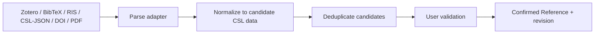

# Citation System

## 1. Core separation

The system maintains three distinct concepts:

- `Reference`: canonical, style-neutral CSL-compatible metadata about a work.
- `CitationUsage`: one occurrence in the document, including locator, prefix, suffix, and note context.
- `RenderedCitation`: disposable output/cache for a specific style, locale, processor version, and input hash.

Formatted APA/Chicago strings must never be parsed back as canonical metadata.

## 2. Canonical reference model

Store CSL-JSON-compatible fields in normalized relational columns where querying/constraints matter and a validated `cslData` JSON projection for processor interoperability. Preserve:

- stable internal `Reference.id`;
- CSL `type`, title/container title, issued date parts, volume/issue/pages, publisher/place;
- structured contributors with ordered roles;
- DOI, ISBN, ISSN, URL and other identifiers;
- language and original title where known;
- raw importer payload, importer/version, imported timestamp;
- field-level source/confidence and confirmation status;
- immutable `ReferenceRevision` history.

Normalization includes DOI casing/URL removal, Unicode normalization, structured dates, and page range normalization without destroying the raw value.

## 3. Import pipeline



Priority for deduplication: normalized DOI → ISBN + type → strong title/author/year similarity. Possible duplicates are proposed, never auto-merged when ambiguity exists.

### Zotero

MVP should first support a user-exported Zotero library/package with item metadata and resolvable PDF attachments. A direct Zotero API adapter may be added later without changing the domain pipeline. The importer records Zotero item keys for repeat-import matching. PDF metadata extraction may fill missing candidates but does not override confirmed Zotero/user fields.

## 4. Citation usage model

Each citation node has a stable ID and one or more ordered citation items:

```ts
interface CitationItem {
  referenceId: string;
  locator?: string;
  label?: "page" | "chapter" | "section" | "figure" | "line" | "note";
  prefix?: string;
  suffix?: string;
  suppressAuthor?: boolean;
  authorOnly?: boolean;
}
```

For evidence transferred from a PDF selection, page locator defaults from the annotation page label/index but remains a usage-level field. Changing a locator never changes the reference.

## 5. Style processing

Initial installed styles:

- APA 6;
- APA 7;
- Chicago author-date;
- Chicago notes and bibliography.

Each `CitationStyle` pins CSL XML checksum and required locales. The processor adapter accepts ordered document citation usages plus canonical references and returns citation clusters, note output, and bibliography entries. Cache key:

```text
processorVersion + styleChecksum + localeChecksum + referenceRevisionSetHash
+ orderedCitationUsageHash + bibliographyConfigurationHash
```

A style change invalidates rendered caches only. It must not update `Reference`, `CitationUsage`, provenance, or document text nodes holding semantic citation IDs.

## 6. Notes and numbering

- `author_note`: user-authored explanatory content.
- `citation_note`: content generated/managed for notes-based CSL styles, with optional user prefix/suffix.
- `endnote`: either semantic note type rendered at chapter/document end per configuration.

The numbering engine is separate from the CSL processor. `noteNumberingScope` is `chapter` or `section`, configurable per project. Both author and citation notes may share a stream by default; configuration can split streams only if export targets support it consistently. Moving a note recalculates display numbering but retains stable note ID.

## 7. Bibliography configuration

Default membership is all non-suppressed references used by active `CitationUsage` records in the current document. `BibliographyConfiguration` supports:

- active citation style and locale;
- `includeMode: cited_only | cited_plus_selected`;
- selected uncited reference IDs;
- hanging-indent and heading presentation settings (non-canonical);
- note mode/numbering scope.

Bibliography order and formatted entries come from the CSL processor. Deleted/tombstoned blocks do not contribute to current bibliography but remain reproducible in historical document versions.

## 8. Figure attribution

Figure source metadata uses the same reference and processor. Attribution composition is semantic:

- figure caption;
- optional original figure number/page locator;
- citation usage/reference;
- optional adaptation indicator (`reproduced`, `adapted`, `author_created_from_data`);
- optional rights note.

The selected citation style controls the reference portion. The application may use a style-specific attribution template, but it must not flatten the underlying source data.

## 9. Validation and test fixtures

- Validate CSL style XML and locales before installation.
- Golden fixtures cover personal/corporate authors, missing dates, same-author same-year disambiguation, multiple works in one cluster, page ranges, chapters, journal articles, books, edited volumes, URLs/DOIs, and non-Latin characters.
- Compare representative output with trusted CSL processor/reference fixtures; do not hand-code APA/Chicago punctuation.
- DOCX/LaTeX export tests verify citation order, note placement, bibliography membership, and style switching.

## 10. Known limitations

- CSL processors do not define every institution-specific figure attribution convention; semantic data remains available for later templates.
- Metadata extraction from PDFs is probabilistic and always requires confirmation.
- Exact Chicago edge cases require fixture validation before claiming full conformance.

