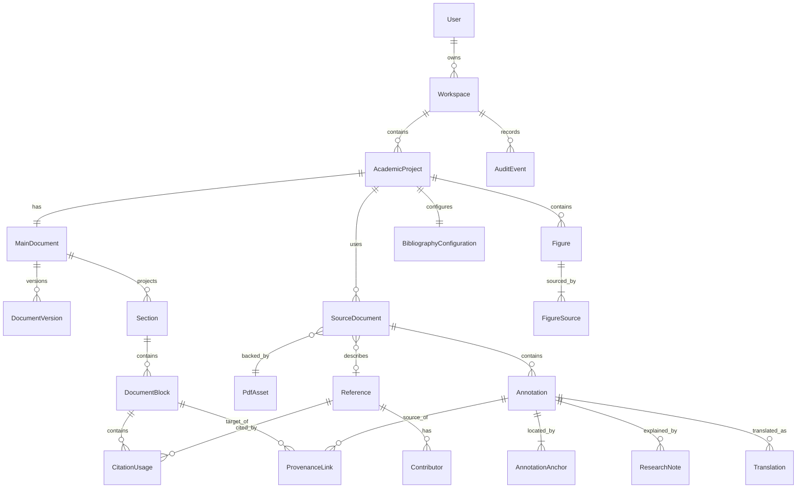

# Data Model

## 1. Modeling conventions

- Primary keys are UUIDs generated on client or server.
- Every owned record carries `workspaceId`; project-scoped records also carry `academicProjectId` to enforce tenant boundaries and simplify offline partitioning.
- Mutable aggregates carry integer `revision`, `createdAt`, `updatedAt`, and optional `deletedAt` tombstone.
- Server time is authoritative; `clientCreatedAt` and `deviceId` are retained where offline origin matters.
- Immutable versions/assets do not update in place.
- Foreign keys default to `RESTRICT`; cascade is used only for disposable projections/caches, never provenance roots.
- User-visible deletion is soft deletion followed by retention-aware purge.

## 2. Relationship overview



## 3. Core entities

| Entity | Purpose and ownership | Relationships/cardinality | Lifecycle, deletion, versioning | Key integrity constraints |
|---|---|---|---|---|
| `User` | Authenticated person; platform-owned identity mapped from OIDC subject. | Owns 0..N workspaces. | Disabled before purge; audit ownership retained/pseudonymized. Profile is revisioned. | Unique issuer+subject; normalized unique email only if trusted. |
| `Workspace` | Security, backup, and sync boundary; owned by one user in MVP. | 1 owner; 0..N projects. | Archive then retention-aware purge. Revisioned. | Owner required; all descendants share workspace ID. |
| `AcademicProject` | Research container and sync revision aggregate. | Belongs to workspace; exactly 1 main document; N sources/figures. | Archive/tombstone; purge blocked by active exports or backup policy. | Unique stable ID; monotonic `serverRevision`. |
| `MainDocument` | Current structured academic work. | Exactly 1 per project; N versions/sections/blocks. | Created with project; never independently hard-deleted. Current snapshot mutable/revisioned. | Valid editor schema/version; project uniqueness. |
| `DocumentVersion` | Immutable recovery/export checkpoint. | N per main document; optional parent version. | Append-only; retained per policy; restore creates a new version. | Content checksum and schema version required; no update. |
| `Section` | Relational projection for navigation/numbering. | Tree within one main document; N blocks. | Rebuilt transactionally from editor tree; cascade only as projection. | No cycles; stable editor node ID; sibling order unique. |
| `DocumentBlock` | Stable addressable projection for provenance/citations. | Belongs to document/section; N citations and provenance links. | Tombstone on editor deletion; retained while history/provenance requires. Revisioned. | Stable `nodeId`; type matches editor node; source-derived block rule. |
| `SourceDocument` | Project-specific scholarly source and metadata link. | Project-owned; one current PDF asset; 0..1 confirmed reference; N annotations. | May replace PDF only by creating a new asset/version association; archive rather than cascade delete. | PDF checksum/version pinned by annotations; confirmed reference required before citation. |
| `PdfAsset` | Immutable original PDF bytes. | Workspace-owned; referenced by N source document versions where checksum matches. | Upload staging → verified → available/quarantined; immutable; purge only when unreferenced and retention elapsed. | SHA-256, byte size, MIME verification, private object key unique. |
| `Reference` | Canonical CSL-compatible bibliographic metadata. | Workspace-owned; N source docs, contributors, citation usages. | Draft → confirmed → merged/archived. Field changes create revision history. | No formatted style string as authority; type and required CSL fields validated contextually. |
| `Contributor` | Ordered person/organization contribution. | Belongs to one reference; N per role. | Replaced as part of reference revision; soft delete for sync. | Ordered unique position per reference+role; structured name fields. |
| `Annotation` | Highlight, sticky note, or region annotation separate from PDF. | Belongs to source document/PDF checksum; 1..N anchors; 0..N notes/translations/links. | Mutable metadata; source identity immutable; tombstone only. | At least one valid anchor; anchor PDF checksum equals source version. |
| `AnnotationAnchor` | Exact PDF location selector. | Belongs to one annotation; page and geometry/text selectors. | Immutable revision; repair creates a new superseding anchor. | Normalized coordinates in bounds; nonempty selector; checksum required. |
| `ResearchNote` | User's reason/interpretation for captured evidence. | Belongs to annotation; may be linked to document blocks. | Revisioned; deletion tombstoned. | Plain/rich content sanitized; not confused with author footnote. |
| `Translation` | One provider output/user-edited revision for annotation text. | Belongs to annotation; optional predecessor translation. | Append-only revisions; may be marked preferred. | Original text hash, source/target language, provider/model, timestamps required. |
| `Figure` | Project-managed image/figure and caption. | Project-owned; 1..N figure sources; inserted by N document blocks. | Revisioned metadata; derived assets immutable; tombstone if removed. | Sourced figures require a reference and source attribution data. |
| `FigureSource` | Provenance for uploaded or PDF-derived figure. | Belongs to figure; references source/PDF/anchor or external source. | Immutable; replacement creates a new source record. | PDF-derived source requires checksum, page, region, reference. |
| `CitationUsage` | A specific citation occurrence, distinct from reference. | Belongs to document block and one reference; optional locator/prefix/suffix. | Revisioned/tombstoned with editor node; render cache disposable. | Stable citation node ID; locator label/value valid; same workspace/project. |
| `CitationStyle` | Installed CSL style identity/version. | Referenced by many configurations/exports. | Styles are immutable by checksum; new style version is a new row. | CSL XML validated; known ID, checksum, locale dependencies. |
| `BibliographyConfiguration` | Project citation/bibliography settings. | Exactly one per project; selects style and manual inclusions. | Revisioned and version-pinned by exports. | Valid note mode, locale, cited-only/manual set semantics. |
| `ExportJob` | Asynchronous immutable-version export request. | Belongs to project/document version; produces 0..N assets. | queued → running → succeeded/failed/cancelled; retry count bounded. | Input version/style checksums pinned; idempotency input hash unique. |
| `AuditEvent` | Append-only record of security/integrity actions. | Workspace-owned; actor/device/request correlation. | Append-only, retention policy; never user-editable. | Event type, occurredAt, actor, target IDs, privacy-safe metadata. |

## 4. Supporting entities required by the architecture

| Entity | Purpose | Important rules |
|---|---|---|
| `ProvenanceLink` | Typed edge from source evidence/figure/translation/note to a target block. | Required for every source-derived block; immutable origin fields; status may become `target_modified`, `source_archived`, or `unresolved`. |
| `ReferenceRevision` | Immutable snapshot and field provenance of canonical metadata. | Import payload and confirmed edits remain traceable. |
| `SourceDocumentVersion` | Pins a source document to a PDF asset checksum. | Existing annotations never retarget automatically to a replacement. |
| `Category` / `Tag` | Workspace vocabulary and many-to-many classification. | Normalized unique name per workspace; associations tombstoned for sync. |
| `OcrResult` | Derived text and geometry per PDF page/model. | Never changes PDF; keyed by asset checksum+page+engine version+language. |
| `DerivedAsset` | Crops, thumbnails, exports, or OCR sidecars. | Parent asset/source required; checksum verified; reproducibility metadata stored. |
| `DeviceReplica` | Device identity, acknowledged project revisions, and last sync. | User can revoke device; no secret is stored as plain database data. |
| `AppliedOperation` | Idempotency ledger for sync operations. | Unique workspace+device+operation ID; retained past tombstone horizon. |
| `SyncConflict` | Preserved competing changes needing resolution. | Never auto-resolve main document with last-write-wins. |
| `BackupManifest` | Schema-versioned inventory of an exported workspace. | Includes record counts, checksums, and required assets. |

## 5. Important logical fields

### `AnnotationAnchor`

```text
id, annotationId, pdfAssetId, pdfChecksum
pageIndex (zero-based), pageLabel (nullable)
selectorType: text | region | ocr_text
rects: [{x, y, width, height}] in normalized unrotated PDF page space
selectedText, exactTextHash
prefixText, suffixText, textStart, textEnd (nullable)
pageTextFingerprint, rotationAtCapture
ocrResultId (nullable), supersedesAnchorId (nullable)
createdAt, clientCreatedAt
```

### `ProvenanceLink`

```text
id, workspaceId, academicProjectId
sourceKind, sourceEntityId
referenceId, sourceDocumentId, pdfAssetId, pdfChecksum
annotationId, annotationAnchorId, translationId, researchNoteId, figureSourceId
targetMainDocumentId, targetDocumentBlockId
originalSelectedText, insertedTextHash, targetContentHashAtLink
status, createdAt, updatedAt
```

## 6. Deletion policy

1. UI delete creates a tombstone and removes the item from normal views.
2. A reference/source/annotation that participates in provenance cannot be hard-deleted while any retained document version refers to it.
3. Removing a source-derived block tombstones the block and citation usage but retains provenance for document history.
4. Workspace purge is an explicit destructive operation requiring recent authentication and a delayed retention window.
5. Object garbage collection uses a database-produced allowlist of unreferenced checksums and never infers reachability from UI state alone.

## 7. Database enforcement

Some invariants require PostgreSQL constraints/triggers or transaction-level validation beyond Prisma:

- composite foreign keys or transaction checks guarantee matching `workspaceId`/`academicProjectId`;
- unique one-main-document and one-bibliography-configuration constraints;
- annotation anchors require a matching PDF checksum/source version;
- source-derived blocks require at least one valid provenance link before transaction commit;
- append-only tables reject update/delete outside administrative retention procedures;
- optimistic updates include `WHERE revision = expectedRevision`.

The developer must document any invariant not enforceable in the database and cover it with application plus integration tests.

