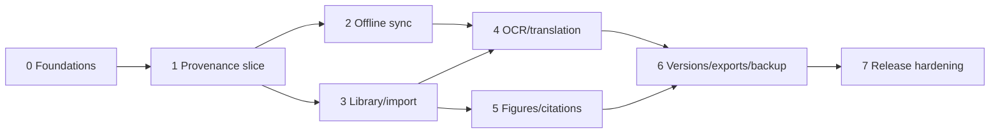

# Implementation Roadmap

## Delivery strategy

One developer implements bounded vertical phases. Every phase ends in a usable, tested state. Provider choices requiring benchmarks are gated; domain interfaces may be built before adapters are selected.

## Phase 0 — Foundations and risk spikes

**Objective:** establish repository quality gates and retire the highest unknowns without building broad UI.

**Scope:** monorepo boundaries; TypeScript/CI/test harness; architecture fitness rules; short prototypes for PDF selection geometry, ProseMirror stable nodes, CSL processor, IndexedDB durability, iPad PWA storage, Zotero sample import, OCR and translation benchmarks.

**Exit:** choices/benchmarks recorded as ADRs; P0 risks have feasible paths; no speculative model/provider is approved.

## Phase 1 — Provenance vertical slice

**Objective:** complete the 12-step core research-to-writing workflow on one desktop browser.

**Scope:** authentication; project/main document; immutable PDF upload; PDF.js viewer; reference confirmation; text selection/hybrid anchor; highlight/research note; structured editor; atomic evidence transfer; source navigation; APA 7 citation; cited-only bibliography; audit events; E2E test.

**Exit:** critical E2E passes against real PostgreSQL/object storage test adapters; provenance validator reports valid.

## Phase 2 — Local-first autosave and explicit cloud sync

**Objective:** work offline and deliberately move work between desktop and iPad without silent loss.

**Scope:** IndexedDB replica; local asset manifest; autosave/recovery ring; outbox/idempotency; project/entity revisions; pull-before-push; conflict copies/UI; second-device flow; PWA installation and cache policy.

**Exit:** offline edit→local save→sync→second-device workflow passes; fault tests prove retry safety.

## Phase 3 — Source library and import

**Objective:** manage a realistic 30–40 PDF project efficiently.

**Scope:** source organization, search/filter, categories/tags, multi-color highlights, sticky notes, BibTeX/RIS/CSL-JSON/DOI/manual import, Zotero exported-library/package import with attachments, metadata confirmation/deduplication.

**Exit:** representative Zotero sample imports repeatably without duplicate assets/references; user can correct metadata.

## Phase 4 — OCR and translation

**Objective:** capture and translate evidence from scanned/multilingual sources while preserving provider/model provenance.

**Scope:** OCR jobs and selectable overlay for Spanish/Latin/Italian/English; translation provider port; approved local desktop adapter; translation revisions/editor insertion; capability and quality warnings; iPad read/edit plus generation only if validated.

**Exit:** benchmark gates met; original/source/anchor/provider metadata survives every translation path.

## Phase 5 — Figures and complete citation styles

**Objective:** manage sourced figures and all required styles.

**Scope:** PDF region crop/upload image; figure source/caption/tags; insertion and navigation; style-aware attribution; APA 6/7 and both Chicago modes; style switching; author/citation footnotes; chapter/section numbering; bibliography manual inclusions.

**Exit:** style switch changes renderings only; figure attribution and note fixtures pass.

## Phase 6 — Versions, exports, backup, and recovery

**Objective:** make work portable and recoverable.

**Scope:** durable checkpoints; version preview/restore-as-new; DOCX and LaTeX intermediate representation/exporters; export jobs; schema-versioned full workspace backup/restore with checksums.

**Exit:** version restore and backup round-trip preserve provenance; export fixtures pass and never become source-of-truth.

## Phase 7 — Responsive hardening and release

**Objective:** release a reliable desktop-first product with full iPad workflow and emergency phone editing.

**Scope:** responsive layouts, touch/keyboard/accessibility, storage quota UX, performance at target scale, security review, malicious-file tests, observability, operational backup/restore drill, onboarding and limitations.

**Exit:** all release gates and acceptance criteria pass on the target device matrix.

## Dependency flow

The single developer should normally follow numerical order. Limited reorder is allowed only when tests and module dependencies remain satisfied.

## Phase completion evidence

Every phase produces:

- implemented acceptance criteria mapped to `ACCEPTANCE_CRITERIA.md`;
- automated test results and manual device evidence where required;
- migration and rollback/restore notes;
- updated ADRs/open decisions;
- no unresolved provenance validation failures;
- a concise list of known limitations.

