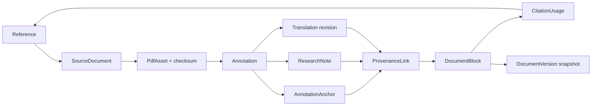

# Provenance Model

## 1. Integrity objective

For every quotation, translated passage, research note, image, or figure transferred into the main document, the system must be able to answer:

1. Which workspace/project owns it?
2. Which structured reference identifies the source?
3. Which immutable PDF bytes were viewed?
4. Which page and exact region/text supplied it?
5. Which annotation/note/translation/figure operation produced it?
6. Which current or historical document block uses it?
7. Has the target text changed since insertion?

Failure to answer these questions is a critical data-integrity incident, not a cosmetic broken link.

## 2. Provenance graph

Figures follow `PdfAsset → FigureSource → Figure → ProvenanceLink → DocumentBlock`.

## 3. Evidence bundle

`TransferEvidenceToDocument` consumes a validated evidence bundle containing:

- `workspaceId`, `academicProjectId`;
- `referenceId`, `sourceDocumentId`, `pdfAssetId`, `pdfChecksum`;
- `annotationId` and at least one `annotationAnchorId`;
- exact original selected text and its hash;
- optional `researchNoteId`, `translationId`, or `figureSourceId`;
- requested target block type and citation locator.

It atomically creates/updates:

- a stable target `DocumentBlock` projection;
- one or more `ProvenanceLink` edges;
- the `CitationUsage` when attribution is required;
- the editor JSON transaction and document revision;
- an `AuditEvent` for provenance creation.

No partially linked target block may commit.

## 4. Anchor resolution

Resolution is deterministic and checksum-first:

1. Load the exact `PdfAsset` identified by checksum. Never resolve against a replacement PDF merely because titles match.
2. Open `pageIndex`; display `pageLabel` to the user where available.
3. Transform normalized, unrotated page-space rectangles to the current viewport.
4. For text anchors, compare exact selected text/text hash with the current text layer.
5. If geometry and text agree, status is `resolved_exact`.
6. If geometry is usable but text differs due to extraction/OCR representation, use prefix/suffix and page fingerprint to propose `resolved_approximate`; show a warning.
7. If the PDF is unavailable or selectors conflict, mark `unresolved`; never silently move to another passage.

OCR anchors additionally pin `ocrResultId`, engine/version, and OCR word geometry.

## 5. Target mutation semantics

- On insertion, store `originalSelectedText`, `insertedTextHash`, and the target block content hash.
- When the user edits a source-derived quotation, recompute the hash.
- Exact match keeps status `verbatim`.
- Whitespace/typographic normalization may be `normalized` if rules are deterministic and recorded.
- Substantive change sets `target_modified`; provenance remains, but UI must not imply an exact quotation.
- Converting a quotation to an unsourced paragraph requires explicit confirmation: either keep provenance as `paraphrase` or detach it. Detachment creates an audit event and is disallowed if a citation would become misleading without user resolution.
- Deleting the target block tombstones the edge for history; it does not delete source evidence.

## 6. Clipboard behavior

The reliable workflow is the explicit editor transfer command. For convenience, internal copy also writes:

- `text/plain` for interoperability;
- a sanitized rich-text representation;
- an application-specific signed/validated JSON payload containing only IDs, hashes, and schema version.

On paste, the application-specific payload is accepted only when IDs resolve inside the authorized workspace and hashes match current source data. External plain text never receives invented provenance.

## 7. Version and export behavior

- Each `DocumentVersion` snapshot includes the set/hash of provenance edges referenced by its block IDs.
- Restore validates all referenced edges before becoming current; unresolved edges are reported, not dropped.
- DOCX and LaTeX exports render human-readable citations/attributions and embed stable internal provenance identifiers where the format permits.
- Workspace backup is the lossless portability mechanism; DOCX/LaTeX are publications, not complete provenance backups.
- Export logs pin PDF/figure/reference/style versions so output can be reproduced.

## 8. Validation and repair

Run provenance validation:

- before committing a transfer;
- before durable document checkpoint/sync;
- before export;
- after backup restore and schema migration;
- periodically as an integrity job.

Validation results classify `valid`, `warning_modified`, `warning_approximate`, or `invalid`. An `invalid` result blocks export of affected source-derived content unless the user removes/repairs it; it never silently exports an unattributed quotation.

Repair may select a superseding anchor, reconnect a missing cached asset to the same checksum, or restore a tombstoned reference. Repair cannot change the original anchor in place and is audited.

## 9. Required invariant tests

- Cross-workspace provenance is rejected.
- Source checksum mismatch is rejected.
- A source-derived block cannot commit without a link and reference.
- Editing target text changes provenance status but preserves the edge.
- Replacing a source PDF does not retarget old anchors.
- Restore retains links to the version's original block IDs.
- Style switching changes rendering only.
- Backup round-trip preserves every provenance graph edge and checksum.

